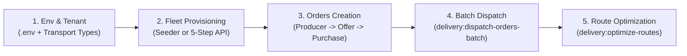

# GoLog TMS Integration — Development Setup Guide

This guide walks through setting up the Cultiva $\leftrightarrow$ GoLog TMS integration on a new development machine, from environment and tenant configuration to driver provisioning, batch order dispatch, and route optimization.



---

## 1. Environment & Docker Setup

1. Copy [`.env.example`](../.env.example) to `.env` inside `backend/` and configure the GoLog credentials:

   ```dotenv
   GOLOG_BASE_URL=http://147.15.18.21:8081
   GOLOG_EMAIL="cultiva@cultiva.com"
   GOLOG_PASSWORD="<your_golog_password>"
   GOLOG_TENANT_ID=5647b3d4-f42f-4905-a617-896afa8dccef
   GOLOG_TIMEOUT=60
   ```

2. Start the containers, install PHP dependencies, and generate the application key:

   ```bash
   cd backend
   docker compose up -d
   docker compose exec php composer install
   docker compose exec php php artisan key:generate
   ```

---

## 2. GoLog Tenant, Transport Types & Optimization Profile

`GoLogClient` automatically sends `X-Tenant-Id: <GOLOG_TENANT_ID>` on authenticated requests when `GOLOG_TENANT_ID` is set.

### Option A — Reuse the Shared Cultiva Tenant (Recommended)

Keep `GOLOG_TENANT_ID=5647b3d4-f42f-4905-a617-896afa8dccef` in `.env` (already pre-filled in [`collection/bruno/environments/local.yml`](../collection/bruno/environments/local.yml)). This tenant already has:
- Cultiva's transport types (`CARGA SECA`, `CLIMATIZADO`, `REFRIGERADO`)
- Default optimization profile (`Equilibrado Cultiva`)
- 3 provisioned drivers, tractors, equipment groups, and work schedules

### Option B — Provision a Brand-New Tenant in GoLog

1. Open the Bruno collection at `backend/collection/bruno` (`local` environment).
2. Run [`GoLog TMS/01. Auth & Setup/01. Login.yml`](../collection/bruno/GoLog%20TMS/01.%20Auth%20&%20Setup/01.%20Login.yml) to store `golog_token`.
3. Run [`GoLog TMS/01. Auth & Setup/08. Create Cultiva Tenant.yml`](../collection/bruno/GoLog%20TMS/01.%20Auth%20&%20Setup/08.%20Create%20Cultiva%20Tenant.yml) with unique `cnpjCpf`, `email`, `adminEmail`, and `adminCpf` values.
   - Bruno's post-response script updates `golog_tenant_id` and `golog_company_id` in `local.yml`.
   - Copy the returned tenant UUID into `GOLOG_TENANT_ID` in `backend/.env`.
4. Populate Cultiva's required transport types (`CARGA SECA`, `CLIMATIZADO`, `REFRIGERADO`) on the new tenant:

   ```bash
   docker compose exec php php artisan golog:populate-transport-types
   ```

5. Create a default optimization profile for the new tenant in GoLog (`POST /optimization-profile` with `"companyId": "<GOLOG_TENANT_ID>"` and `"isDefault": true`).

---

## 3. Driver & Fleet Provisioning

A [`GoLogDriver`](../domain/Models/Delivery/GoLogDriver.php) is considered fully provisioned (`isProvisioned() === true`) once all 5 external identifiers exist:
`golog_user_id` $\to$ `golog_driver_id` $\to$ `golog_tractor_id` $\to$ `golog_equipament_group_id` $\to$ `golog_work_schedule_id`.

### Fast Path — Seed Existing Live GoLog Drivers (Recommended with Option A)

If you are using the shared tenant (`5647b3d4-f42f-4905-a617-896afa8dccef`), run migrations and seeders:

```bash
docker compose exec php php artisan migrate:fresh --seed
```

[`GoLogDriverSeeder`](../database/seeders/GoLogDriverSeeder.php) populates `users`, `companies`, `addresses`, `golog_drivers`, and `golog_vehicles` with the 3 live drivers and their GoLog API UUIDs.

### Manual Path — Register New Drivers via the 5-Step API

If you created a new tenant or want to register additional drivers, run migrations first (`docker compose exec php php artisan migrate`) and execute the 5 requests under `collection/bruno/API/GoLog Drivers/` in order. Each step persists independently so partial failures can resume from the stopped step (`getStoppedStep()`):

| Step | Bruno Request | Endpoint | Persistence & Validation Notes |
| :---: | :--- | :--- | :--- |
| **1** | [`01. Create User.yml`](../collection/bruno/API/GoLog%20Drivers/01.%20Create%20User.yml) | `POST /v1/golog/users` | Creates local `User`, `Company`, `Address`, and `GoLogDriver`, plus GoLog `DRIVER` user (`golog_user_id`). Auto-saves `access_token` in Bruno. Requires valid CPF, CNPJ, and CEP. |
| **2** | [`02. Create Driver.yml`](../collection/bruno/API/GoLog%20Drivers/02.%20Create%20Driver.yml) | `POST /v1/golog/drivers` | Creates GoLog driver (`golog_driver_id`). Requires Bearer `access_token`, valid 11-digit CNH check digits, and `cnh_expiration` in `YYYY-MM-DD` (formatted to `dd/MM/yyyy` for GoLog). |
| **3** | [`03. Create Vehicle.yml`](../collection/bruno/API/GoLog%20Drivers/03.%20Create%20Vehicle.yml) | `POST /v1/golog/vehicles` | Creates GoLog tractor and local [`GoLogVehicle`](../domain/Models/Vehicle/GoLogVehicle.php) (`golog_tractor_id`). Requires valid Mercosul/old plate and 11-digit `renavam`. |
| **4** | [`04. Create Equipament Group.yml`](../collection/bruno/API/GoLog%20Drivers/04.%20Create%20Equipament%20Group.yml) | `POST /v1/golog/equipament-groups` | Associates `golog_tractor_id` into a GoLog equipment group (`golog_equipament_group_id`). |
| **5** | [`05. Create Work Schedule.yml`](../collection/bruno/API/GoLog%20Drivers/05.%20Create%20Work%20Schedule.yml) | `POST /v1/golog/work-schedules` | Creates an active shift in GoLog (`schedule_date` `YYYY-MM-DD`, `start_time`/`end_time` `HH:mm`) and stores `golog_work_schedule_id`. |

---

## 4. Creating Producers, Retailers, Offers & Pending Delivery Orders

1. Ensure the `product-source` catalog service is running and reachable at `PRODUCT_SOURCE_BASE_URL` (default `http://host.docker.internal:8001/api`).
2. Ensure the queue worker container is running (`docker compose up -d worker`) so `PurchaseCreated` events are processed when `QUEUE_CONNECTION=redis`.
3. **Register a Producer and a Retailer**:
   - Run [`API/auth/Signup (Producer).yml`](../collection/bruno/API/auth/Signup%20%28Producer%29.yml) and [`API/auth/Signup (Retailer).yml`](../collection/bruno/API/auth/Signup%20%28Retailer%29.yml) (or invoke [`SignUpAction`](../domain/Auth/Actions/SignUpAction.php)).
   - Mark both accounts verified (`is_verified = true`) via document verification or Tinker:
     ```bash
     docker compose exec php php artisan tinker --execute="Cultiva\Models\User\User::query()->update(['is_verified' => true]);"
     ```
4. **Create Product Offers (as Producer)**:
   - Authenticate via [`API/auth/Login.yml`](../collection/bruno/API/auth/Login.yml) as the Producer and run [`API/Offers/Create Offer.yml`](../collection/bruno/API/Offers/Create%20Offer.yml) ([`CreateOfferAction`](../domain/Models/Offer/Actions/CreateOfferAction.php)).
5. **Purchase Offers (as Retailer)**:
   - Authenticate as the Retailer and run [`API/Purchases/Buy Offer.yml`](../collection/bruno/API/Purchases/Buy%20Offer.yml) ([`CreatePurchaseAction`](../domain/Models/Purchase/Actions/CreatePurchaseAction.php)).
   - [`CreateDeliveryOrderListener`](../domain/Models/DeliveryOrder/Listeners/CreateDeliveryOrderListener.php) automatically creates a [`DeliveryOrder`](../domain/Models/DeliveryOrder/DeliveryOrder.php) with `status = pending` and PostGIS pickup/dropoff [`DeliveryAddress`](../domain/Models/DeliveryOrder/DeliveryAddress.php) coordinates.

---

## 5. Batch Dispatching Delivery Orders to GoLog

Dispatch all `pending` [`DeliveryOrder`](../domain/Models/DeliveryOrder/DeliveryOrder.php) records that do not yet have a [`GoLogShipment`](../domain/Models/DeliveryOrder/GoLogShipment.php):

```bash
docker compose exec php php artisan delivery:dispatch-orders-batch
```

What [`DispatchDeliveryOrdersBatchAction`](../domain/Integrations/GoLog/Actions/DispatchDeliveryOrdersBatchAction.php) does:
- Extracts `longitude` and `latitude` from PostGIS `delivery_addresses.coordinate` for both `pickupAddress` and `dropoffAddress`.
- Groups orders by product category (`Frutas`, `Verduras`, `Legumes`, `Tubérculos e raízes`, `Grãos e cereais`) and sends one `POST /integration/invoices/json` batch per category.
- Generates paired invoice items per order: `COLETA` (pickup at the producer) and `ENTREGA` (dropoff at the retailer).
- Persists two [`GoLogShipment`](../domain/Models/DeliveryOrder/GoLogShipment.php) records (`status = PENDENTE`, `type = COLETA` and `type = ENTREGA`) per order with their returned `golog_shipment_id`.

---

## 6. Route Optimization in GoLog

Trigger GoLog's VRP route optimizer across all `PENDENTE` shipments and all fully provisioned driver work schedules:

```bash
docker compose exec php php artisan delivery:optimize-routes
```

What [`OptimizeDeliveryRoutesAction`](../domain/Integrations/GoLog/Actions/OptimizeDeliveryRoutesAction.php) does:
- Collects all `PENDENTE` `golog_shipments.golog_shipment_id` values and all provisioned `golog_drivers.golog_work_schedule_id` values.
- Sends a single `POST /api-route-optimization` request with `"routePriority": "TEMPO"`.
- Transitions optimized [`GoLogShipment`](../domain/Models/DeliveryOrder/GoLogShipment.php) records to `AGUARDANDO_INICIO`.

### Inspecting Routes & Logs

- **Bruno**:
  - [`GoLog TMS/04. Route Optimization/01. Optimize Routes (VRP).yml`](../collection/bruno/GoLog%20TMS/04.%20Route%20Optimization/01.%20Optimize%20Routes%20%28VRP%29.yml) — manual VRP trigger
  - [`GoLog TMS/04. Route Optimization/02. List Transports.yml`](../collection/bruno/GoLog%20TMS/04.%20Route%20Optimization/02.%20List%20Transports.yml) — generated trips (`GET /transport`)
  - [`GoLog TMS/04. Route Optimization/04. List Route Stops.yml`](../collection/bruno/GoLog%20TMS/04.%20Route%20Optimization/04.%20List%20Route%20Stops.yml) — ordered route stops (`GET /route-stops`)
- **Application Logs**: Every outbound GoLog response (`endpoint`, `status`, `body`) is logged in `backend/storage/logs/laravel.log`.
